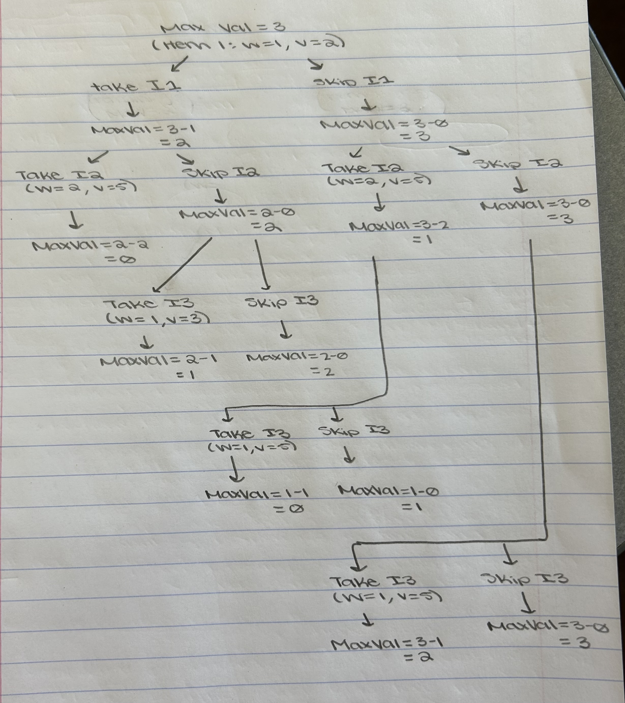

# Lab 07: The Integer-Valued Knapsack Problem

**Name:** Ainslee Plesko

## Introduction

In this lab, you will explore different variations of the Knapsack problem and design a dynamic programming solution for one of them. You may work in small groups or individually, but everyone should write up their own answers to the questions below.

Suppose we're going hiking. We have items $1, \ldots, n$ that we could pack in multiples with corresponding values $v_1, \ldots, v_n$ and weights $w_1, \ldots, w_n$. For example, we might have a water bottle (weight 1, value 2) and a sandwich (weight 2, value 5). Consider the following three problem variations:

1.  Maximize value subject to capacity $W$, where you can pack at most one of each item.
2.  Maximize value subject to capacity $W$, where you can pack a positive integer value of each item.
3.  Minimize weight subject to minimum value $V$, where you can pack a positive integer value of each item.

------------------------------------------------------------------------

## Part 1: Dynamic Programming Fundamentals

**Question:** Which of the three problem variations can be solved using the dynamic programming approaches we've studied in lecture? Explain your reasoning.

*Your Answer:* All three variations can be solved with dynamic programming when the item weights and values are positive integers. For variation 1, the table keeps track of which items have been considered, so each item can be used at most once. For variation 2, the table allows an item to be used more than once. Both use the capacity $W$ to organize the calculations. For variation 3, the table can track possible total values and the minimum weight needed to reach them, then choose the lightest option that reaches at least $V$.

## Part 2: The Naive Recursive Algorithm

Below is a naive recursive algorithm intended to solve one of the variations listed above.

``` text
Function MaxValue(W):
    if W == 0:
        return 0
        
    max_val = 0
    for i from 1 to n:
        if w_i <= W:
            current_val = v_i + MaxValue(W - w_i)
            if current_val > max_val:
                max_val = current_val
                
    return max_val
```

**Question:** Which of the three problem variations (1, 2, or 3) does this algorithm solve? How do you know? Explain your reasoning.

*Your Answer:* This solves variation 2: it maximizes value subject to capacity $W$ while allowing unlimited copies of each item. Each recursive call chooses an item and continues with the remaining capacity, so the same item can be chosen again. It does not solve variation 1 because it does not prevent reuse, or variation 3 because it maximizes value under a weight limit rather than minimizing weight to reach a target value.

## Part 3: Recursion Tree

Consider the following simple example: \* **Knapsack Capacity:** $W = 3$ \* **Item 1:** Weight $w_1 = 1$, Value $v_1 = 2$ \* **Item 2:** Weight $w_2 = 2$, Value $v_2 = 5$ \* **Item 3:** Weight $w_3 = 1$, Value $v_3 = 3$

**Question:** Draw the full recursion tree for `MaxValue(3)` using the example above. Label the remaining capacity at each node and indicate which item is chosen along each branch.

*Your Answer (take a picture and upload it):* 

## Part 4: Recurrence Relation

**Question:** Derive a mathematical recurrence relation for $OPT(W)$, the maximum value you can pack into a knapsack of capacity $W$, based on the naive recursive algorithm. Be sure to state your base case(s) and explain how you arrived at your formula.

*Your Answer:* Let $OPT(W)$ be the maximum value that can be packed into a knapsack of capacity $W$. The base case is $OPT(0)=0$, because if the capacity is zero, there is no room for any item. For any $W>0$, the naive recursive algorithm considers each item $i$ such that $w_i \leq W$, adds its value $v_i$, and then solves the same problem on the remaining capacity $W-w_i$. Therefore, the recurrence is

$$
OPT(W) = \begin{cases}
0, & W=0 \\
\max_{i: w_i \leq W} \{v_i + OPT(W-w_i)\}, & W>0
\end{cases}
$$

If no item fits in the remaining capacity, then the value is $0$. This formula matches the recursive algorithm because each call tries every possible item that fits and chooses the option that gives the greatest total value.

## Part 5: Bottom-Up Dynamic Programming

Instead of using the slow recursive approach, we can build a table bottom-up.

**Question:** Use your recurrence relation from Part 4 to fill in the following table for all three items provided in Part 3 ($w_1=1, v_1=2$; $w_2=2, v_2=5$; and $w_3=1, v_3=3$). At each step, record the optimal value and the specific item chosen to achieve that value.

| Capacity ($W$) | Optimal Value ($OPT$) | Item Chosen |
|:--------------:|:----------------------|:------------|
|     **0**      | 0                     | —           |
|     **1**      | 3                     | Item 3      |
|     **2**      | 6                     | Item 3      |
|     **3**      | 9                     | Item 3      |
|     **4**      | 12                    | Item 3      |
|     **5**      | 15                    | Item 3      |
|     **6**      | 18                    | Item 3      |

*Explain how you calculated the row for* $W=6$\
For $W=6$, the recurrence says we compare the value of taking each item that fits and then continuing with the remaining capacity:

$$
OPT(6) = \max\{v_1 + OPT(5),\; v_2 + OPT(4),\; v_3 + OPT(5)\}
$$

Using $v_1=2$, $v_2=5$, and $v_3=3$, this becomes

$$
OPT(6) = \max\{2 + 15,\; 5 + 12,\; 3 + 15\} = \max\{17, 17, 18\} = 18.
$$

So the best choice is to take Item 3, which gives the largest total value. Since Item 3 has weight 1 and value 3, it can be chosen repeatedly.

## Part 6: Traceback

**Question:** Using the "Item Chosen" column from the table you completed in Part 5, trace back to find the exact quantities of each item to pack that maximize the value. What is the final optimal packing configuration for $W=6$ and the maximum value?

*Your Answer:* Starting from capacity $W=6$, the table says the optimal choice is Item 3. After taking it, the remaining capacity is $6-1=5$. The optimal choice at each subsequent capacity is also Item 3, so we continue until the capacity reaches $0$.

So the final optimal packing is:

-   6 copies of Item 3
-   0 copies of Items 1 and 2

This uses a total weight of $6 \times 1 = 6$ and a total value of $6 \times 3 = 18$. Therefore, the maximum value for a knapsack of capacity 6 is 18, and the optimal configuration is six copies of the item with weight 1 and value 3.